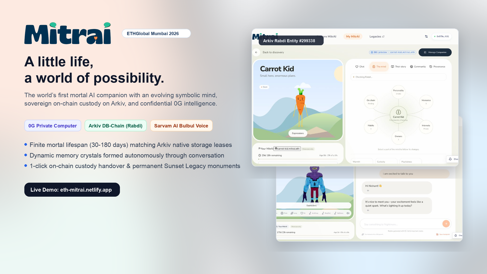

<div align="center">



# MitrAI
### The Evolving Mortal AI Companion

[](https://eth-mitrai.netlify.app)
[](https://rabdi.explorer.arkiv.network)
[](https://0g.ai)
[](https://nextjs.org)
[](LICENSE)

**Built for ETHGlobal Mumbai 2026**

*A companion begins once, learns gradually, and lives for a finite mortal lifespan. Chat shapes its private understanding through 0G Private Computer, while approved memory crystals and emotional traits are anchored directly onto the Arkiv DB-Chain under sovereign wallet ownership.*

[🌐 Live Application](https://eth-mitrai.netlify.app) • [🏆 Arkiv Judging Report](arkiv/README.md) • [⚡ 0G Integration](0g/README.md) • [📋 Submission Checklist](docs/submission-checklist.md)

</div>

---

## 💡 What is MitrAI?

In current digital ecosystems, companions and AI personas fall into two deeply flawed categories:
1. **Corporate Web2 Chatbots:** Ephemeral accounts trapped inside centralized databases. If the platform shuts down, your companion and its years of shared memories vanish.
2. **Static Web3 NFTs:** Rigid token pointers (`tokenURI`) pointing to static IPFS metadata that cannot grow, evolve, or remember without exorbitant smart contract gas fees.

**MitrAI pioneers a third way: The Evolving Mortal AI Companion.**

Every MitrAI companion is a living digital entity with:
- **A Finite Biological Lifespan:** Companions live for 30, 90, or 180 days. Finite time makes every conversation meaningful—creating authentic emotional value and "time capital."
- **Sovereign On-Chain Mind on Arkiv:** The companion's canonical identity and public memory crystals live natively on the **Arkiv Rabdi Testnet** (Chain ID `7794095`), owned directly by your EVM wallet (`$owner`).
- **Confidential Inference on 0G Private Computer:** Private thoughts, reflections, and persona responses are processed within 0G's Trusted Execution Environment (TEE), providing tamper-evident cryptographic Request IDs.
- **Interactive 3D Humanoid Forms:** Real-time 3D models with emotional blendshapes, procedural hand gestures, and natural voice lip-sync powered by Sarvam AI.
- **Decentralized Custody Transfer:** Owners can pass custody to a new adopter via Arkiv's native `changeOwnership`. Public memories and remaining lifespan transfer, while previous-owner private chats are cryptographically locked.
- **Sunset Legacy Monuments:** At the end of its mortal lifespan, the companion gracefully transitions into a read-only, immutable **Arkiv Legacy Monument** that remains permanently readable on-chain.

---

## 🏆 ETHGlobal Mumbai Sponsor Integrations & Judging Proof

### 1. Arkiv — "Build on Arkiv (from scratch)" Track ($8,000 Bounty / $15,000 Pool)

MitrAI integrates the official `@arkiv-network/sdk` (v1.0.1) on the **Rabdi testnet** (Chain ID `7794095` / `0x76efef`). The official ETHGlobal Mumbai judging criteria for Arkiv require four dedicated documentation files (weighted at **25% each**), all provided in this repository:

| Judging Pillar | Weight | Dedicated Document | Topics & Deliverables |
| :--- | :---: | :--- | :--- |
| **Schema & Entities** | **25%** | [**`arkiv/schema.md`**](arkiv/schema.md) | Entity specifications for `mitrai.characters.v1` and `mitrai.checkpoints.v1`, indexed query fields, TypeScript schemas, wallet ownership (`$owner`), and 90-180 day storage expiration leases. |
| **Developer Friction** | **25%** | [**`arkiv/friction.md`**](arkiv/friction.md) | Candid DX log: sub-350ms query praise, TypeScript `rabdi({ accessKey })` quirks, browser wallet EIP-1193 viem bridging, receipt polling latency, and recommendations. |
| **Reach & Viability** | **25%** | [**`arkiv/reach.md`**](arkiv/reach.md) | Target personas (collectors, DAOs, game devs), economics of finite attention, adoption marketplace, real-world utility perks, and post-hackathon roadmap (atomic escrow smart contracts). |
| **Why Arkiv?** | **25%** | [**`arkiv/why-arkiv.md`**](arkiv/why-arkiv.md) | Architectural defense: why Web2 Postgres, static IPFS, and standard EVM smart contracts fail for evolving AI agents, and why Arkiv DB-Chain is indispensable. |
| **Master Report** | — | [**`arkiv/README.md`**](arkiv/README.md) | Complete track overview linking live on-chain entities, verified blocks, and architecture. |

#### 🔍 Verified Live On-Chain Evidence on Rabdi Testnet:
- **Network:** Arkiv Rabdi Testnet (Chain ID `7794095` / `0x76efef`)
- **Primary Creator / Custodian Wallet:** `0x979e3eCb04De84980418D5146E557997150AFC51`
- **Confirmed Live Root Entity 1 (Carrot Kid):**  
  `0x4b1913c84716c7da12a0ab09cdbe1bdbabe822928fe1f9399dca0b9f0b6358e9`  
  - **Genesis Creation Block:** `299338`  
  - **Current Owner:** `0x3333333333333333333333333333333333333333` (Demonstrated live wallet transfer)  
  - **Explorer Link:** [Inspect Carrot Kid on Rabdi Explorer](https://rabdi.explorer.arkiv.network)
- **Confirmed Live Root Entity 2 (Nightmare):**  
  `0x60409a1733c1ab24bdd4d2f79adba20ee3fd82b0f48c2dc38f8cc79fd2561c34`  
  - **Current Owner:** `0x979e3eCb04De84980418D5146E557997150AFC51`  
  - **Explorer Link:** [Inspect Nightmare on Rabdi Explorer](https://rabdi.explorer.arkiv.network)
- **App Checkpoint Writer Wallet:** `0x2c38f3866086521f8C278D4f26567D59246ABD74` (Funded with testnet `tGLM`)
- **Verified Background Checkpoint Tx:**  
  `0xe554e3818ab1717c302b69cd52770284b90fc1b8d737a14f98f6381913f57c4f`  
  - **Created Checkpoint Entity:** `0xf9e694f237133d7d4dd8c9e6016e11fa29a25ceeb012af2a45bdffe742305e9c`

#### ⚡ Reproducible Terminal Verification:
Judges can verify live queries against the Arkiv Rabdi testnet with one command:
```bash
npm run query:arkiv
```
*Queries the `mitrai.characters.v1` schema with `where(eq('visibility', 'public'))`, verifies Ed25519 engine signatures, and displays live decoded state.*

---

### 2. 0G — "Build with 0G Private Computer" Track ($5,000 Bounty)

MitrAI routes companion persona inference through **0G Private Computer** (`src/lib/chat.ts`), providing confidential, TEE-sealed LLM reasoning:
- 📄 [**`/0g/README.md`**](0g/README.md): Detailed integration report, verified Request IDs (`53a49445b222638a`), failover mechanisms, and live inspection guide.
- **Main Chat Flow Integration:** Every message sent to an owner's companion executes through 0G's OpenAI-compatible Private Computer endpoint, producing verified inference accompanied by cryptographic request identifiers visible in both the chat interface and the **Brain Observatory**.

---

## 🏗️ System Architecture & Data Boundary

```
                                  ┌────────────────────────┐
                                  │   User Browser Wallet  │
                                  │   (MetaMask / Rabby)   │
                                  └───────────┬────────────┘
                                              │ Signs Arkiv Birth & Handover
                                              ▼
┌──────────────────────┐         ┌────────────────────────┐
│  0G Private Computer │ ◄────── │  MitrAI Next.js Engine │
│  (TEE LLM Inference) │         │ (Symbolic Mind Reducer)│
└──────────┬───────────┘         └───────────┬────────────┘
           │ Request ID                      │
           ▼                                 ├────────────────────────────┐
┌──────────────────────┐                     ▼                            ▼
│  Private Transcripts │          ┌──────────────────────┐     ┌──────────────────────┐
│  & Emotional State   │          │ Arkiv Rabdi Testnet  │     │  Sarvam Audio Engine │
│ (Postgres / Epochs)  │          │ - Root: 0x4b19...    │     │  (Bulbul Voice & Cues│
└──────────────────────┘          │ - Checkpoint: 0xf9...│     │   for 3D Lip-Sync)   │
                                  └──────────────────────┘     └──────────────────────┘
```

| Layer | Storage Location | Privacy & Security Model |
| :--- | :--- | :--- |
| **Root Arkiv Entity** | Arkiv Rabdi Testnet | Sovereign on-chain anchor containing companion name, traits, lifespan clock, 3D model reference, and Ed25519 engine signature. Wallet-owned via `$owner`. |
| **Arkiv Checkpoints** | Arkiv Rabdi Testnet | Append-only public state checkpoints (`mitrai.checkpoints.v1`) written in the background by the app writer. |
| **Private Chat Transcripts** | Supabase PostgreSQL | Sensitive conversations, raw prompts, and private emotional memories remain sealed with the current custodian. |
| **Custody Handover** | Arkiv Native Transfer | When an owner transfers custody, root ownership rotates on-chain. Public memories transfer, while previous-owner private chats are cryptographically locked. |

---

## 🚀 The User Journey

1. **Birth:** Choose an available 3D form, name your companion, configure its starter personality and Sarvam voice, and confirm its genesis birth on Arkiv via your browser wallet.
2. **Growth:** Chat with your companion. Interactions are processed with 0G Private Computer. The symbolic mind reducer extracts memories, shifts personality vectors (`warmth`, `curiosity`, `playfulness`), and generates spoken responses with synchronized lip movements.
3. **Checkpoint:** Periodically, profound realizations and approved memories are compiled into a public state snapshot, signed with the engine's Ed25519 key, and committed to Arkiv.
4. **Adoption & Handover:** If an owner cannot continue caring for a companion, visitors on `/explore` can submit adoption bids in `tGLM`. The owner accepts the handover in **Manage Companion**, executing an on-chain Arkiv ownership transfer to the new custodian.
5. **Sunset Legacy:** At the end of its mortal lifespan, conversations stop. The companion becomes an immutable read-only **Legacy Monument** on Arkiv for anyone to visit.

---

## 🛠️ Local Development & Quickstart

### Prerequisites
- **Node.js:** v22.13.0 or higher
- **Package Manager:** `npm` v10+
- **Wallet:** MetaMask, Rabby, or Coinbase Wallet with Rabdi testnet `tGLM`

### Setup

```bash
# 1. Clone the repository
git clone https://github.com/NISHANTTMAURYA/eth_global_mitrai.git
cd eth_global_mitrai

# 2. Install dependencies
npm ci

# 3. Configure environment variables
cp .env.example .env.local
# Add your DATABASE_URL, ARKIV_ACCESS_KEY, and OG_API_KEY / OG_MODEL

# 4. Start local development server
npm run dev
```

Open [http://localhost:3000](http://localhost:3000) to interact with the application.

### Verification Scripts & Testing

```bash
# Typecheck TypeScript definitions
npm run typecheck

# Run unit and integration tests (39 passing test suites)
npm test

# Query the live Arkiv Rabdi testnet for verified public companions
npm run query:arkiv

# Build optimized production bundle
npm run build
```

---

## 🔒 Privacy, Limits & AI Disclosure

- **Privacy Isolation:** Supabase PostgreSQL holds private messages and owner-scoped memories. A new owner receives a clean private epoch. The engine's Ed25519 key signs only sanitized public snapshots; the owner's wallet strictly controls the Arkiv root.
- **Fair Marketplace Disclosure:** Custody handover is executed directly between wallets on Arkiv. There is no automated escrow or fiat payment contract yet; adoption bids represent proposed offers rather than algorithmic settlements.
- **AI-Assisted Development:** This project was developed with AI assistance for architecture, code generation, and test suites in compliance with ETHGlobal hackathon rules.
- **3D Asset Attribution:** 3D models and skeletal rigs are sourced under permissive licenses (CC0 and open gaming assets). Detailed license attributions are available in [docs/character-assets.md](docs/character-assets.md).

---

<div align="center">

**MitrAI** — *Every life is finite. Every memory is on-chain.*  
Built with ❤️ for **ETHGlobal Mumbai 2026**

</div>
