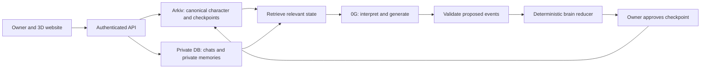

# MitrAI — create, cultivate, discover and adopt

Runnable local MVP for ETHGlobal Mumbai · updated 6 November 2026.

Read [the delivered product flow](docs/product-flow.md) for current behavior and remaining limits. The [earlier flow audit](docs/current-flow-audit.md) records the gaps before this revision. Older product/design sections below still contain roadmap material.

## Current product journey

Choose an available named template → customize its personality and reusable voice → connect a wallet and approve creation → talk and see evidence-backed development → publish → request/accept free adoption → hand over without resetting age → Sunset and read-only Legacy. Each model can create one canonical persona. The home page opens an existing owner’s companion automatically. See [the delivered product flow](docs/product-flow.md) for reservation, confirmed birth timing, privacy and remaining limits. Paid settlement is not implemented.

## Run the implementation

Requires Node.js 22.13+ (tested with Node 25.6).

```sh
npm ci
npm run dev
```

Open `http://localhost:3000` in a browser with an Ethereum wallet. **Connect wallet → create a character → approve its Rabdi transaction → converse → review/checkpoint → publish**. A cancelled activation keeps a resumable draft. Local rehearsal is available only with `MITRAI_DEMO_MODE=1`; it is disabled by default.

```sh
npm run typecheck
npm test
npm run build
npm run test:integration
```

The integration command starts a production server with a disposable isolated SQLite database, exercises the HTTP flows, and removes only its own temporary data. Browser checks now cover gallery caching/clipping, avatar framing, and the check-in interface; see the dated implementation reports for their limits.

### Live configuration

Follow [the configuration checklist](docs/configuration.md) for account links, keys, test gas and the first live run.

Copy `.env.example` to `.env.local`. Live conversation uses Google Vertex AI when `GEMINI_USE_VERTEX=true` with `GOOGLE_CLOUD_PROJECT`, using Application Default Credentials. `GEMINI_MODEL` selects the model. Optional 0G inference exists as a configured alternative. The current runtime does not select the older Bedrock settings. Without a configured provider the UI labels scripted rehearsal, and personalized proactive generation requires live inference.

See [the growing-mind research and implementation](docs/growing-mind.md) and [check-in operations](docs/proactive-setup.md). Private conversations now have a dated SQLite archive and searchable memory beyond the latest 100-message display window. A semantic planner proposes grounded facts, communication preferences and future check-ins. Durable jobs deliver a contextual in-app message after an event or one unanswered 90-minute reconnection, subject to quiet hours and user controls. Resend email and standards-based web push are implemented with opt-in settings. Live email still needs a Resend key and verified sender; no real email delivery is claimed.

### Future sponsor integrations (not currently used)

- **0G Compute:** planned as the decentralized inference option for persona conversations. The server would send the persona's approved state and relevant memory to a 0G model and record its actual request ID. This could make conversation inference part of the product's 0G integration. No 0G API calls or storage are part of the current application.
- **World ID:** planned as an optional verified-person creation allowance to discourage duplicate persona creation. It would verify the person on the server before allowing creation. It is not implemented and does not gate onboarding today.

Google Vertex AI is currently the primary live model path. These integrations are roadmap items and are not claimed as working prize integrations.

Sign in with a browser wallet and create a character. Activation requests its initial Arkiv write; **The mind → Sync to Arkiv** signs later public checkpoints. The server verifies the result before recording the entity key. **Discover on Arkiv** queries public records and accepts only this app verifier’s signed snapshots. The script `npm run query:arkiv` reproduces the schema query, optionally filtered with `ARKIV_OWNER`. No live transaction was executed during implementation, so writer addresses and live entity evidence remain pending.

Real handover first requires the existing owner to sign Arkiv ownership transfer, then the app reconciles the new owner and starts a new private ownership epoch. There is no payment or escrow contract.

### Storage and trust

SQLite and the Ed25519 verifier key live in ignored `.data/` (or `MITRAI_DATA_DIR`). Preserve this directory for continuity; do not publish it. Chats, the full dated archive, private mind state and proactive plans are separated by character, owner and ownership epoch. This SQLite database is not encrypted at rest; the server operator can read it. The app signs sanitized public state; private messages and memory evidence are excluded. The canonical birth registry and trusted verifier enforce official lifetimes. This is a single-server hackathon architecture, not permissionless finality or a serverless Postgres deployment.

### Character media

Dynamic spoken replies and greetings now use actual speech audio with Rhubarb timing. See [timed speech setup](docs/timed-speech-setup.md) for local executables, optional Sarvam voice configuration, model capabilities and verified limits. Named speech morphs and VRM vowel shapes are driven from audio playback time; arbitrary numeric facial shapes still require mapping.

Gallery characters use a 15% projection-size increase; the chat scene uses a 10% increase. The bundled model forms have embedded, retargeted or procedural body animations. See [lip-sync research and plan](docs/lip-sync-research.md) for techniques, model mouth capabilities and the proposed audio/viseme pipeline. Sarvam audio generation has been live-tested; browser and cross-language quality still need broader evaluation.

Sixteen rigged GLB models from Downloads are copied to `public/models/downloads`. Each is offered as a named starting template. Public studio seeding is restricted to explicitly enabled local demo mode. A form can belong to only one character globally: used forms are disabled in the picker and duplicate API requests are rejected. Some imported models have no body clips; named facial visemes animate when available. Source licences need confirmation before redistributing imported models publicly.

The remaining sections describe the product flow and longer-term design; implementation status is authoritative in `state.md`.

MitrAI is an open platform for cultivating unique 3D characters with memories, habits and personality. Creators invent uses; the platform supplies creation, evolution, publishing, discovery and ownership transfer. Each character has a finite lifetime ending at **Sunset**, followed by a read-only **Legacy**.

This revision supersedes the earlier emphasis on a daily personal companion and relegation of selling to a later product. Discovery and adoption are core journeys. Paid settlement remains unimplemented and must not be presented as working.

## Hackathon Target & Simplified User Flow

For ETHGlobal Mumbai, the application is streamlined around three direct, high-impact features built on the **Arkiv** track:

### 1. User-First Landing Journey (`/`)
* **First Page Experience:**
  * **When an owner visits `/`:** If they already have an active persona, it immediately loads **their persona** (interactive 3D avatar, Sarvam voice responses, memory stats, and real-time life meter).
  * **When a new user or visitor arrives at `/`:** If they have no persona yet, the page displays a clean, focused prompt with two distinct buttons:
    * **"Create a Character"**: Opens Step 1 creation (pick 3D model, define personality, preview zero-credit voices).
    * **"Explore Characters"**: Takes them to `/explore` to browse the community gallery and adoption marketplace.
* **Top Navigation:** `/explore` remains the permanent route to search all active and legacy personas.

### 2. Buying, Selling & Buy Requests (Arkiv Testnet Track)
* **Prize Track:** **Arkiv ("Build on Arkiv")** on **Rabdi Testnet**.
* **How It Operates:**
  * Every persona is an on-chain **Arkiv Entity** whose `$owner` is the creator's wallet address.
  * **Set Asking Price:** When publishing, the owner chooses between *Showcase* (view only) or *For Adoption / Sale* and sets a testnet price (e.g., `0.05 ETH` or `10 tGLM`).
  * **Browse & Audition on `/explore`:** Prospective buyers can view 3D character stages, read public highlights, and listen to authentic Sarvam AI voice previews (zero API cost).
  * **Send Buy Request:** A buyer clicks **"Send Buy Request"** on any listed persona to propose an offer amount and a note to the creator.
  * **Accept & Handover:** The owner reviews incoming buy requests and clicks **"Accept & Handover"**, executing Arkiv's native `arkiv.transfer(entityKey, buyerAddress)`.
  * **Privacy Guarantee:** Transfer moves public traits, age, and approved highlights to the buyer, while the seller's private chat database remains locked and purged from the new owner's view.

### 3. The Aging & Mortality Logic (Emotional Hook)
* **Why Mortal AI?** Infinite chatbots feel disposable. Because a MitrAI persona has a finite lifespan (30 days standard, or 10 minutes in demo mode), every single interaction carries real emotional weight.
* **Chronological Clock (The Countdown):**
  * Time steadily counts down: `remaining = (createdAt + lifespan) - now`.
  * When time reaches zero $\rightarrow$ **Sunset (Death)**. The persona permanently becomes an immutable, read-only **Legacy / Memoir** on Arkiv.
* **Maturity (Experience Gained Before Death):**
  * Sitting idle burns time without gaining wisdom.
  * Meaningful chat sessions award **Experience Points**, allowing the persona to develop deeper vocabulary, refined habits, and distinct traits before its sunset.
  * If a creator can no longer dedicate time to their persona, they can list it for **adoption/sale** to let another owner give it a full life before time runs out.

### 4. Non-Owner Experience: The Mind Orbit & Inner Monologue
To maintain the intimacy of the companion bond and preserve privacy, visitors browsing someone else’s persona cannot engage in unrestricted two-way chat. Instead, they experience the persona’s mind through:
* **The Inner Monologue:** A one-click spoken soliloquy where the 3D persona animates on stage and shares a 15–20 second voiced reflection in its authentic Sarvam AI voice—reflecting on its origin, its personality, and how many days it has left until Sunset.
* **The Mind Orbit (Memory Constellation):** An interactive visual ring of orbiting nodes around the avatar displaying public traits, approved memory crystals, and conversational habits. Explorers can inspect what makes this mind unique without accessing the seller’s private chat history.

### 5. On-Chain Identity & Agent Passports (ENS Track)
* **Prize Track:** **Ethereum Name Service (ENS)** ($10,000 pool).
* **Companion Subname Passports (`[name].mitrai.eth`):**
  * Every persona is assigned a canonical ENS subname under `mitrai.eth` (e.g., `milo.mitrai.eth`).
  * Cryptographic `namehash` is dynamically derived using `viem/ens`.
* **Standard EIP-2304 Text Records:**
  * Binds the persona's on-chain **Arkiv** entity key (`arkiv.entity`), mortal status (`agent.status`), current owner (`agent.guardian`), 3D form (`agent.model`), and remaining lifetime (`agent.lifespan`).
  * Clickable `⟐ [name].mitrai.eth` badges in discovery and profile views launch an interactive **ENS Agent Passport** modal.
* **Subname Resolution Gateway:**
  * MitrAI serves an open HTTP gateway at `/api/ens/[name]` (e.g. `/api/ens/milo.mitrai.eth`) allowing external dApps to resolve the agent's verified records without proprietary SDKs.
* **Collector Reverse Resolution:**
  * When a collector connects their wallet, the app queries Ethereum RPC via `viem.getEnsName` to resolve their `0x...` address to their primary ENS name (e.g., `vitalik.eth`) in the header and provenance logs.
* Complete documentation: See [`ens/README.md`](ens/README.md), [`ens/use-case.md`](ens/use-case.md), [`ens/schema.md`](ens/schema.md), and [`ens/how-you-use-ens.md`](ens/how-you-use-ens.md).

## Product decisions

- Core loop: **create → cultivate → demonstrate → publish → discover → adopt → continue → Sunset**.
- No fixed use-case category. Creators can explore games, storytelling, interviewing, commentary or other activities with free-text definitions and tags.
- Quality over volume: one active cultivation slot per account, editable drafts, no bulk creation and no rewards for creation counts. Selling should not instantly replenish a creation allowance; choose an explicit cooldown. Wallet/account limits alone cannot enforce one-per-human.
- Ownership is exclusive within the official service. Public data can still be copied elsewhere.
- Lifespan is fixed at creation and runs offline. Transfers, payments and storage renewals never extend it.
- Final lifespan is undecided. Thirty days is a hypothesis requiring enough time for cultivation and adoption; use a clearly labeled ten-minute demo character for judging.
- Sunset ends interaction and evolution; a read-only legacy preserves approved history.
- Buyer value must be visible: distinctive behavior, permitted transferable knowledge, demonstrated abilities, history and time remaining. Age and scarcity alone do not guarantee demand.

## Website and onboarding

Discovery comes first. Use warm ivory, charcoal and muted amber, expressive 3D previews, and clear lifetime information.

| Page | Purpose |
| --- | --- |
| `/` | Personal companion home: directly loads the owner's active persona (chat, 3D stage, life clock); or shows a clean welcome card with "Create a Character" and "Explore Characters" if no persona is owned yet |
| `/explore` | Dedicated public discovery & marketplace: browse active personas, audition voices with zero credits, inspect asking prices, and send buy requests |
| `/create` | Free-text identity, behavior, optional purpose, appearance, starting temperament, example dialogue and draft preview |
| `/onboarding` | Wallet login, optional human verification, creation/adoption review and transaction confirmation |
| `/companion/[id]` | Owner's 3D character, chat/play, activities, remaining time, memory controls and save status |
| `/companion/[id]/mind` | Traits, habits, memories and explanations of changes |
| `/publish/[id]` | Preview public bio, demonstrations, approved history, transferable state and availability |
| `/characters/[id]` | Public profile, evidence of abilities, isolated audition and offer/adopt action |
| `/transfer/[id]` | Recipient, remaining lifespan, included assets/data and handover confirmation |
| `/companion/[id]/history` | Creation, checkpoints, confirmed ownership changes and lifecycle |
| `/legacy/[id]` | Frozen character and approved biography; no conversation |
| `/settings` | Planned account controls; current connection and integration settings open in the header dialog |

### Creation flow

1. Browse first. Cards show a distinctive description, demonstrations, creator, availability and time remaining. Avoid ranking solely by message volume.
2. Choose **Create** or **Adopt**. Adoption allows participation without generating another persona.
3. For creation, answer “Who is this being?” and “How does it behave?” Optionally describe something to explore together. Inspiration examples are optional; accept original purposes.
4. Choose a bundled licensed GLB body, name, colors and starting temperament. Add example dialogue and boundaries. Preview responses in a draft before its lifespan starts. Custom model upload is stretch scope.
5. Connect an EVM wallet through its injected browser provider and sign an expiring nonce-bound login message. If World is implemented, verify the creation allowance on the server and bind it to this session. Cancellation leaves browsing available.
6. Review exact lifespan, public-state visibility, private-memory rules and permanent Sunset. Check Arkiv network/gas and sign creation. Confirmed creation starts the clock; refresh recovery uses transaction receipts rather than creating a duplicate.
7. Talk, play scenarios, practise activities and give feedback. Approve useful memories and public highlights separately. A shared goal is optional; conversation alone does not prove a skill or grant tool access.

### Cultivation and saving

Load confirmed state from Arkiv → verify current owner and lifecycle → retrieve that ownership epoch's private memories → call the configured conversation model → validate proposed events → apply bounded evolution rules → show provisional changes → owner signs a session checkpoint → show confirmed state.

Keep signing at session boundaries rather than every message. Unsaved changes must be labeled. Backend signing requires explicitly authorized supported delegation; it cannot silently impersonate the owner.

### Publishing

Creation does not automatically publish or list a character. Choose **Introduce to the world** when ready:

1. Write a public bio and choose free-form discovery tags.
2. Select demonstrations and approved experiences; preview the exact public and transferable package.
3. Distinguish creator claims from evaluated abilities and include demonstration/checkpoint dates.
4. Choose **Showcase only**, **Open to offers**, or **Listed for transfer**. A paid listing also requires price, currency, expiry and an actually implemented settlement mechanism.
5. Sign the Arkiv publishing write. The gallery queries these records and links to the canonical character state.

Drafts, private chats and owner-specific facts stay off public storage. Unlisting removes discoverability in the app; it cannot make previously public data secret. Stale listings must be invalidated on ownership changes or Sunset.

### Discovery, audition and buying

Every profile must answer “Why this character?” Show behavior examples, useful knowledge, personality development, history, included assets/permissions and exact remaining lifespan. Example creations might be a sarcastic dungeon guide, cricket commentator or interviewer for fictional villains. These are possibilities, not mandatory categories.

Allow a short **isolated audition** from the public checkpoint. This deliberately revises the original owner-only conversation rule: only the owner cultivates the canonical brain, while visitors try disposable public context. Auditions never read private memories, change the brain or earn experience. Apply a small allowance/rate limit and stop auditions at Sunset.

Adoption flow: discover → inspect evidence → audition → review price/offer and included state → confirm recipient and remaining lifetime → settle through the implemented mechanism → verify canonical ownership → revoke old sessions → start the new owner's private relationship. MVP must demonstrate actual wallet-to-wallet transfer. Until paid settlement exists, use offers and clearly labeled transfer, not a pretend Buy button. Multi-network payment and Arkiv handover are not automatically atomic.

The new owner receives the canonical character and approved transferable knowledge/assets. Previous-owner chats and personal facts stay behind. Lifetime never resets. Reputation and transaction evidence must not imply guaranteed future performance or resale value.

## Product research informing this revision

Checked 6 November 2026. These products provide design references; none proves demand for this exact marketplace.

- [Character.AI creation guide](https://support.character.ai/hc/en-us/articles/50608869548699-2-Creating-a-Character-Quickstart-Guide-%CF%89): definitions, example dialogue, tags and publishing controls.
- [Virtuals](https://www.virtuals.io/): agent discovery organized around offerings and jobs.
- [Inworld](https://inworld.ai/resources/voice-ai-for-ai-character-apps): distinctive persona and voice as part of the character experience.
- [Spore.fun case study](https://arxiv.org/abs/2506.04236): experimental agent evolution, not evidence of sustainable buyer demand.

## Age and Sunset logic

Use creation block/time as the anchor and store a fixed duration. The browser countdown is display only; the API checks the confirmed anchor and server time before every message, queued reply, save and transfer.

```text
sunsetAt = anchoredCreationTime + lifespanSeconds
lifeProgress = clamp((now - anchoredCreationTime) / lifespanSeconds, 0, 1)

0–20%: Dawn        — establish a relationship and initial interests
20–75%: Bloom      — build habits and pursue the shared goal
75–100%: Golden    — reflect on selected experiences and prepare a legacy
100%: Sunset      — stop interactive actions and freeze canonical state
Afterwards: Legacy — read-only viewing
```

Experience grows separately from elapsed time. Spending time together changes what the character knows; being older does not automatically make it smarter. Slow stable-trait changes and allow quick temporary mood changes. Cosmetic lifecycle changes may affect lighting, accessories and animation; don't force every model into human biological aging.

At Sunset, freeze the latest confirmed brain plus any explicitly approved final checkpoint committed before the deadline. A closing note can be prepared shortly beforehand. If the app is offline, the deadline still passes: the next request derives the correct state without depending on a timer job.

**Enforcement boundary:** an owner-controlled Arkiv record can be edited by its owner. Keep a registered immutable birth commitment and accept only engine-verified transitions in the official service. This is application-enforced finality with a trusted verifier. Protocol-wide irreversible finality would require an independently enforced registry/contract design; it is not supplied by a JSON field or a signature alone.

Arkiv storage expiration is separate. Keep renewable records available after Sunset so the legacy survives. Renew before expiration and back up the identity/state. Missing a renewal is a storage failure, never the intended lifecycle event. See [Arkiv expiration](https://docs.arkiv.network/writing/expiration/).

## Brain architecture

Read [the concrete brain specification](docs/brain-spec.md) and [research index](research/README.md).

The brain is structured identity, traits, episodes, beliefs, goals, habits and retrieval metadata. A deterministic reducer updates it. An external language model interprets chat and expresses replies; it does not replace the persistent state. No neural network is trained for this character engine.



## Proposed implementation stack

| Need | Choice and purpose |
| --- | --- |
| Frontend/API | Next.js + TypeScript; one application for pages, authentication and server routes |
| Interface | Tailwind CSS + shadcn/ui; accessible dialogs and clear transaction states |
| Wallets | wagmi + viem + RainbowKit; ownership checks and owner-signed writes |
| 3D | Three.js through React Three Fiber + Drei; GLB loading, idle/listening/thinking animation |
| Public state | `@arkiv-network/sdk`; live character and checkpoint reads/writes |
| Private data | PostgreSQL + Drizzle; per-owner chats, memory evidence and sessions |
| Model calls | Amazon Bedrock (current). 0G Private Computer is a planned alternative; record real request IDs if implemented. |
| Optional human check | World IDKit is a future option for a one-person creation allowance; not implemented. |
| Asset storage | Object storage initially; Swarm adapter if time permits |
| Hosting | Vercel plus hosted PostgreSQL; server-only secrets and model credentials |
| Background tasks | Expiry monitoring, storage renewal alerts and legacy preparation; correctness must not depend on jobs firing |

Pin package versions after checking current documentation. Don't mix old Arkiv examples and current schemas. Confirm provider credentials, SDK APIs and supported models with sponsor docs before coding.

### Data layout

`Character`: canonical key and wallet owner; public ID, name, birth commitment, lifespan, current version, public brain bytes and asset hash/reference. Derive lifecycle from the trusted anchor.

`Checkpoint`: character key, sequence, previous hash, state hash, rule version, engine signature, sanitized accepted events and compact public state. Verify signature, linkage and author before treating a record as canonical.

`PrivateMemory` in Postgres: owner + character + ownership epoch, text, confidence, source message IDs and consent. Never retrieve memories from an earlier ownership epoch for a new owner.

`TransferEvent` history: derive confirmed ownership events, retain receipts and reconcile current root ownership. A custom `owner` string is never authentication.

Index the fields the UI queries: entity type/schema, character ID, lifecycle deadline and visibility where useful. Filter current ownership using the system owner field. Respect current entity/bytes limits; the complete chat history never belongs inside one root.

### API responsibilities

- `POST /api/auth/challenge`, `/verify`: nonce, origin and session validation.
- `POST /api/human/verify`: validate World results and consume a scoped creation allowance.
- `GET /api/characters/:id`: verified public state with derived lifecycle.
- `POST /api/characters/:id/chat`: owner/lifespan checks, private retrieval, 0G call and schema validation.
- `POST /api/characters/:id/checkpoint`: prepare a bounded state transition for owner signing; recheck version and deadline when accepting confirmation.
- `POST /api/characters/:id/transfer`: prepare handover and revoke old app access after confirmed ownership changes.
- `GET /api/legacies`: query confirmed public legacy records.

The implementation consolidates these operations into `GET/POST /api/auth` and `GET/POST /api/app` with validated action names. World verification is not implemented.

## Prize strategy and evidence

Primary: **Arkiv — Build on Arkiv (from scratch)**. Potential extra tracks: **0G — Build with 0G Private Computer** and **World — Best Use of IDKit**. These are ideas only; neither integration is currently used. Swarm is an optional Arkiv bonus. Rules checked 6 November 2026; [official full prize list](https://ethglobal.com/events/mumbai/prizes).

### Arkiv submission checklist

Use live Rabdi writes and a visible read feature; publish a licensed repository, AI disclosure, writer wallets and a reproducible query. Prepare:

- `arkiv/schema.md`: entities, queried fields, ownership and expiry.
- `arkiv/friction.md`: actual obstacles, expected/observed behavior and reproduction.
- `arkiv/reach.md`: target users, trial link and evidence.
- `arkiv/why-arkiv.md`: user benefit over a conventional database; off-chain boundaries.
- `arkiv/how-you-use-arkiv.md`: connect filters, edit rights and expiry to visible behavior.

Four judging categories have equal weight. SDK installation alone and unread logs do not qualify. Only one Arkiv track award is available per team. [Official Arkiv rules](https://ethglobal.com/events/mumbai/prizes/arkiv)

**Writer wallets:** pending user-authorized live deployment. **Runnable query:** `npm run query:arkiv`; optional `ARKIV_OWNER` filter. Arkiv evidence files now describe the implemented code; live transaction links and real user measurements remain outstanding.

### Extra 1: 0G

Future idea only: route persona conversations through 0G Compute, pass relevant approved character context, and display the real request ID. We do not use 0G at present. If added, the integration should make the persona's evolving memory and return visits central to inference rather than present a generic chat wrapper. [0G requirements](https://ethglobal.com/events/mumbai/prizes/0g)

### Extra 2: World

Future idea only: use IDKit to ration a finite persona creation allowance per verified human. Verify server-side and ensure cancelled/rejected checks create no persona. World is not used in the current product. [World requirements](https://ethglobal.com/events/mumbai/prizes)

ENS was considered but its track needs meaningful ENSv2 functionality on supported networks. Displaying a resolved name is insufficient; a real character namespace and permissions system would add cross-network work. Keep it out of this MVP. [ENS requirements](https://ethglobal.com/events/mumbai/prizes/ens)

### Optional Swarm bonus

Put a public GLB and legacy artwork on Swarm, reference them in Arkiv, and load them in the UI. Record upload/read code, node/service, postage batch and buyer/provider, reproducible steps, a real entity/reference pair, demo timestamp and friction in `arkiv/swarm.md`. Never publicly expose an encrypted reference containing a secret key. This bonus stays within the Arkiv partner selection. [Bonus rules](https://ethglobal.com/events/mumbai/prizes/arkiv)

## Build order

1. Foundation: wallet session, character creation, live Arkiv dashboard, one GLB.
2. Brain: private chats, Bedrock response (or optional 0G testnet response), validated events, reducer, signed checkpoint and reload.
3. Lifecycle: correct countdown, server gating, closing moment and legacy page. Include a real short-lived demo character.
4. Publishing and discovery: live Arkiv gallery, approved demonstrations, isolated audition, offers, second-wallet adoption, provenance and private-data isolation.
5. Submission evidence and documentation; record the full demo.
6. Optional: World; then Swarm. Do not delay core completion for a marketplace, tokens, custom model training or arbitrary 3D generation.

## Demo and checks

Aim for a narrated 2:30 video: creation and exact deadline → conversation changes a memory/habit → reload proves Arkiv persistence → show a 0G request ID → hand over to a second wallet → demonstrate private-memory separation → show a short-lived character reach Sunset and reject chat → open its legacy. Include World success/failure if claiming that prize. Keep real elapsed lifecycle behavior; label demo duration explicitly.

Check: replayed/expired signatures; old-owner access; simultaneous checkpoint versions; rejected transactions; refresh during creation; 0G outage without fabricated answers; chat crossing the deadline; storage expiry; private-data leaks in model context; repeated-feedback farming; missing/corrupt GLB. Measure actual latency, costs and tester feedback.

## Repository and setup handoff

```text
README.md
idea.md                      # original concept; lifecycle superseded here
LICENSE                      # add when implementation repository is created
.env.example                 # add variable names without secrets
src/app/                     # planned pages and API routes
src/lib/arkiv/               # schemas, queries, signed write preparation
src/lib/brain/               # types, retrieval, appraisal, reducer, validation
src/lib/ai/                  # 0G adapter
src/lib/auth/                # wallet and optional World checks
src/components/character/   # avatar renderer and expression mapping
docs/brain-spec.md
docs/submission.md
arkiv/                       # sponsor evidence drafts
research/README.md
research/download_manifest.json
research/papers/
research/scripts/
```

Expected environment: Arkiv RPC/chain ID, database URL, session secret, 0G endpoint/credentials/model and optional World configuration. Never place private keys in public frontend environment variables. The app should provide dependency installation, migrations, local start, demo seeding and query commands once implemented; no runnable app is claimed by this planning package.

Preserve meaningful Git history, disclose pre-existing work and AI assistance, and confirm the chosen participation category using the event's [official information hub](https://ethglobal.com/events/mumbai/info). The public general [rules page](https://ethglobal.com/rules) does not expose every Mumbai submission detail. Include these planning files and accurately describe how they were created; do not invent implementation or user evidence.
